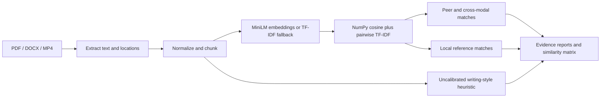

# Multimodal Academic Integrity Screening Prototype

A local Python screening tool for comparing PDF, DOCX, and MP4 submissions. It extracts document text, transcribes spoken audio, compares passages across submissions and a local reference corpus, and writes evidence-rich reports for human review. Scores are investigative signals; they do not determine misconduct or authorship.

## Architecture



| Module | Responsibility |
|---|---|
| `src/extractors.py` | PDF/DOCX text extraction; FFmpeg audio conversion; faster-whisper transcription |
| `src/normalizer.py`, `src/chunker.py` | Text cleanup, conservative repeated-template filtering, and location-preserving chunks |
| `src/embeddings.py`, `src/indexer.py`, `src/similarity.py` | MiniLM or TF-IDF vectors, exact NumPy cosine index, and supplementary lexical cosine |
| `src/pipeline.py` | Batch orchestration, peer/reference comparisons, risk coverage, and aggregate similarity matrix |
| `src/external_checker.py`, `src/ai_detector.py` | Local reference loading and a separate uncalibrated writing-style heuristic |
| `src/explainability.py`, `src/reporter.py` | Passage-level evidence and individual/aggregate JSON, Markdown, and CSV outputs |
| `run_integrity_check.py` | Backward-compatible CLI, input discovery, validation, and batch exit status |
| `scripts/` | Synthetic dataset generation and manifest-based evaluation |

## Ingestion and matching

- **PDF:** PyMuPDF extracts text by page. Scanned image PDFs are not OCR-processed.
- **DOCX:** `python-docx` reads paragraphs and table rows.
- **MP4:** FFmpeg extracts mono 16 kHz audio. Silent audio is detected before inference. faster-whisper transcribes speech into segments with start/end times; video frames are not analyzed. A Whisper load or extraction error is reported for that file, while the batch continues.
- **Chunking:** the default is 300 whitespace-delimited tokens with 45-token overlap. Page and paragraph boundaries are preserved; transcript chunks retain time ranges from their Whisper segments.
- **Embeddings:** `sentence-transformers/all-MiniLM-L6-v2` is the primary model. It returns normalized 384-dimensional vectors. NumPy uses exact in-memory cosine comparisons. If MiniLM cannot load, a corpus-fitted scikit-learn TF-IDF vectorizer is used and reports label it as a lexical-only fallback; it is not semantic similarity.
- **Combined score:** `0.8 × vector cosine + 0.2 × pairwise TF-IDF cosine`. With MiniLM, the first term is semantic cosine. With the fallback, it is TF-IDF vector cosine. The configured threshold defaults to `0.60` and can be changed with `--threshold`; the hold-out evaluation uses the fixed `0.60` threshold. Chunks shorter than 12 words are not compared. A document is excluded from matching against itself.
- **Peer signal:** percentage of eligible submission chunks with at least one peer match. The matrix contains the maximum combined score for each document pair.
- **External signal:** percentage of eligible chunks matching `reference_data/references.json` (or a supplied `--reference_dir`). This is a local corpus lookup, not live internet search. The sample reference content is synthetic.
- **AI-style indicator:** a separate, reproducible but uncalibrated heuristic. For inputs with at least 20 words, it computes `clip(0.30 × (1 − min(1, sentence_length_CV)) + 0.35 × (1 − type_token_ratio) + 0.35 × min(1, 4 × repeated_bigram_rate), 0, 1)`. Shorter inputs receive 0 with an insufficient-text explanation. It is not a probability estimate or authorship classifier and does not affect integrity risk.
- **Risk bands:** the larger of peer and local-reference coverage determines the label: MEDIUM begins at 10%, HIGH at 25%. Use `--risk_medium` and `--risk_high` to configure these coverage boundaries.
- **Boilerplate:** recognizable administrative/template sentences are removed only when repeated across the batch; frequency alone does not suppress repeated analytical findings.

Reports link to the original submission and include matched excerpts, source document/reference, page or timestamp location, and scoring components. Each run writes one JSON and Markdown report per supported input, plus `aggregate_summary.json`, `aggregate_summary.md`, and `similarity_matrix.csv`. Unsupported files are reported as skipped. Individual extraction errors do not terminate a batch; setup or pipeline errors are fatal. If there are no supported files, the CLI exits with status 2.

## Requirements and installation

Use **Python 3.11** and install FFmpeg before running MP4 processing. FFmpeg includes `ffprobe`, used by the dataset generator.

Install FFmpeg:

- macOS: `brew install ffmpeg`
- Debian/Ubuntu: `sudo apt-get update && sudo apt-get install ffmpeg`

Check that it is available with `ffmpeg -version`.

From the project root, create an environment, install the pinned dependencies, and run the sample dataset:

```bash
python3.11 -m venv .venv && .venv/bin/python -m pip install -r requirements.txt && .venv/bin/python run_integrity_check.py --input_dir ./sample_submissions --output_dir ./reports --reference_dir ./reference_data
```

On Windows, create the environment with `py -3.11 -m venv .venv`, then use `.venv\Scripts\python.exe` in place of `.venv/bin/python` in the install and run commands. Install FFmpeg and add its `bin` directory to `PATH`.

On first use, Sentence Transformers downloads `sentence-transformers/all-MiniLM-L6-v2` from the Hugging Face Hub. faster-whisper downloads its CTranslate2 `tiny` speech model when the first MP4 is processed. These downloads require network access unless the models are already available in the Hugging Face cache. Set `HF_HOME` to choose a cache directory; keep model files outside this repository. MiniLM load failures are logged and use the explicitly labeled TF-IDF fallback. Whisper has no semantic substitute: if it cannot load, the affected video receives a processing error. `--skip_video` disables video processing explicitly.

Useful CLI options:

```bash
.venv/bin/python run_integrity_check.py --threshold 0.60 --chunk_size 300 --overlap 45 \
  --device cpu --batch_size 32 --reference_dir ./reference_data \
  --risk_medium 10 --risk_high 25 --verbose
```

## Dataset, reports, and evaluation

The development dataset has 14 fictional submissions: 6 PDFs, 5 DOCX files, and 3 MP4s. Two videos contain 10–30 seconds of generated English speech matched to text submissions; a third is a 12-second silent control. The set includes exact copies, paraphrases, independent originals, a synthetic LLM-style sample, an empty PDF, and a corrupt PDF. `sample_submissions/dataset_manifest.json` records ground truth and known degraded files. `scripts/generate_dataset.py` regenerates it using the system TTS engine (`say` on macOS, `espeak-ng` or `espeak` elsewhere).

Generating new speech samples requires one of those local TTS engines. TTS is not needed to process the checked-in MP4 samples.

The separate synthetic hold-out has five submissions and ten candidate pairs. It is generated by `scripts/generate_holdout.py`; its fixed threshold is not selected using the hold-out examples. Both datasets and the local reference corpus are fictional. The evaluator computes pair-level confusion matrices and exact-copy, paraphrase, cross-modal, and boilerplate-control results from the manifests.

The current results are controlled regression results, not real-world accuracy estimates:

- **Development:** TP/FP/FN/TN = 11/0/0/80; precision/recall/F1 = 1.000/1.000/1.000.
- **Hold-out:** TP/FP/FN/TN = 6/0/0/4; precision/recall/F1 = 1.000/1.000/1.000.

See [EVALUATION.md](EVALUATION.md) for scenario metrics, actual failure and ambiguous cases, methodology, and limitations.

Run tests and regenerate evaluations with:

```bash
.venv/bin/python -m pytest -q
.venv/bin/python scripts/generate_dataset.py
.venv/bin/python run_integrity_check.py --input_dir sample_submissions --output_dir reports --reference_dir reference_data --threshold 0.60
.venv/bin/python scripts/evaluate.py
.venv/bin/python scripts/generate_holdout.py
.venv/bin/python run_integrity_check.py --input_dir evaluation/holdout_submissions --output_dir evaluation/holdout_reports --reference_dir reference_data --threshold 0.60
.venv/bin/python scripts/evaluate.py --reports_dir evaluation/holdout_reports --manifest evaluation/holdout_submissions/dataset_manifest.json
```

The checked-in reports are generated from the fictional datasets. Reports can contain extracted source text; for real submissions, use a private `--output_dir` outside this repository. Tracked sample reports can change if overwritten.

## Limitations

The datasets are small, synthetic, and contain related passages. The development threshold was informed by development examples; the independent hold-out is small and does not establish generalization. The perfect scores should not be interpreted as performance on real student work. Scanned PDFs are not OCR'd, ASR can misrecognize speech, the AI-style heuristic is uncalibrated, and external matching is limited to the supplied local corpus. Matching uses in-memory vectors and a dense all-pairs matrix, so this prototype is for small batches, not production workloads. Reviewers must inspect source passages and original media.

## Scaling to 10,000 submissions

### Embedding and vector-index trade-offs

The current prototype stores normalized 384-dimensional MiniLM vectors in an exact NumPy in-memory index. Vectorized matrix multiplication gives exact scores for small batches, while the all-pairs matrix requires memory quadratic in chunk count. MiniLM captures meaning-preserving rewrites better than lexical counts but adds PyTorch runtime, model downloads, and CPU inference cost. The TF-IDF fallback is smaller and faster but lexical-only and can miss paraphrases. At larger scale, Qdrant or Milvus with HNSW can reduce candidate-search latency and avoid a full all-pairs matrix, at the cost of approximate recall, index memory, and operational complexity. Retain an exact Flat path for validation and rerank retrieved candidates with exact cosine and lexical scores.

Register immutable submissions through an API or watched object-storage bucket and enqueue ingestion jobs (for example, Redis Streams, RabbitMQ, or Kafka). Persist metadata, extraction state, source locations, review decisions, and report pointers in PostgreSQL; store originals and derived transcripts in encrypted object storage. Separate PDF/DOCX CPU workers from MP4 workers. FFmpeg and Whisper are CPU-heavy; GPU workers may improve throughput when utilization and model memory justify their cost. Keep retries bounded, use idempotency keys, and route repeated failures to a dead-letter queue.

Generate embeddings in distributed batches and cache them by content hash, model/version, normalization version, and chunking settings. Use HNSW for approximate retrieval at scale and monitor recall against exact search. Filter candidates by assignment/cohort and boilerplate policy, then rerank with exact cosine and lexical checks. Scale workers based on queue age, CPU/GPU use, and throughput. Measure OCR/transcription, model inference, embedding throughput, storage, and report fan-out before sizing infrastructure. Track stage latency, queue depth, error rates, model versions, candidate counts, and review outcomes; avoid logging student content in general telemetry.

## AI coding assistant disclosure

AI coding assistants were used to accelerate implementation and debugging. The architecture, methodology, evaluation, and implementation were reviewed during development. The implementation was tested with the documented automated suite and synthetic pipeline runs.

## License status

No license has been selected because the rights holder and licensing conditions have not been established. Public access does not grant permission to reuse, modify, or redistribute this project.
