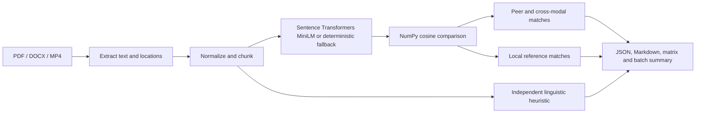

# Multimodal Academic Integrity Screening Prototype

A local Python prototype that extracts text from PDF and DOCX files, transcribes MP4 audio when FFmpeg and faster-whisper are installed, compares chunks against peer submissions and a local reference corpus, and writes reviewer-oriented JSON and Markdown reports. It provides screening signals for human review; it does not determine misconduct.

## Problem and architecture

The project helps reviewers find passages worth checking across a small collection of submissions. It turns PDF pages, DOCX paragraphs/table rows, and timestamped MP4 speech transcripts into text chunks, scores candidate overlap, and keeps the source excerpts and locations beside each signal. A report is an investigation aid, not a finding of misconduct.

## Features and architecture



The responsibilities are separated by module:

| Module | Responsibility |
|---|---|
| `src/config.py` | Defaults for similarity, chunking, device, batch size, and risk coverage bands |
| `src/extractors.py` | PDF/DOCX extraction; FFmpeg audio conversion and faster-whisper transcription |
| `src/normalizer.py`, `src/chunker.py` | Text cleanup, conservative repeated-template filtering, location-preserving chunks |
| `src/embeddings.py`, `src/indexer.py`, `src/similarity.py` | MiniLM/TF-IDF vectors, exact NumPy index, cosine and supplementary lexical scores |
| `src/pipeline.py` | Batch orchestration, peer/reference matching, risk coverage and aggregate matrix |
| `src/external_checker.py`, `src/ai_detector.py` | Local reference loading and separate uncalibrated writing-style heuristic |
| `src/explainability.py`, `src/reporter.py` | Passage/location evidence and individual/aggregate JSON, Markdown, CSV outputs |
| `run_integrity_check.py` | Backward-compatible CLI, input discovery, validation and batch exit status |
| `scripts/generate_dataset.py`, `scripts/generate_holdout.py`, `scripts/evaluate.py` | Synthetic data creation and manifest-based evaluation |

The signals have distinct meanings: peer percentage is the share of eligible submission chunks with peer matches; external percentage is the share matching the supplied local reference corpus; the AI-style score is a reproducible but uncalibrated linguistic heuristic. The AI score does not affect plagiarism risk. Match reports carry the exact excerpts, source document/reference, page or timestamp locations, and scoring components so a reviewer can verify the evidence.

- PDF pages, DOCX paragraphs and table rows, and Whisper segment timestamps are retained as chunk metadata.
- Configurable chunks default to 300 whitespace-delimited tokens with 45-token overlap. Page and paragraph boundaries are preserved; a long source segment is divided with overlap.
- Sentence Transformers `sentence-transformers/all-MiniLM-L6-v2` is the primary embedder. It produces normalized 384-dimensional semantic vectors. If package loading, compatibility, or model loading fails, the system logs the full reason and uses a corpus-fitted scikit-learn TF-IDF vectorizer. Reports label this as a lexical-only fallback and include the model error; it is never described as semantic similarity.
- Similarity uses a combined score: `0.8 × embedding cosine + 0.2 × pairwise TF-IDF cosine`. The 0.8 term is MiniLM semantic cosine when that model loads; in fallback mode it is explicitly TF-IDF vector cosine. Chunks under 12 words are excluded to avoid table labels and fragments. The configured threshold is 0.60 and is frozen for the hold-out run. The development examples are synthetic and cannot establish a transferable operational threshold.
- Repeated template or administrative sentences are counted across documents and removed only when present in at least half the batch and at least three documents (known marked templates may be removed across two). Frequency alone does not remove repeated analytical findings. The cue list is conservative and misses unmarked or paraphrased boilerplate.
- Risk labels use peer or local-reference coverage only: HIGH at 25% or above, MEDIUM at 10% or above, otherwise LOW. These coverage boundaries are configurable with `--risk_medium` and `--risk_high`. The AI-style heuristic is a separate indicator and does not alter plagiarism risk.

## Technology

Python 3.11+, PyMuPDF 2.1, python-docx 1.2, NumPy 2.3, scikit-learn 1.8, Sentence Transformers 6.3, PyTorch 2.15, faster-whisper 1.2.1, CTranslate2 4.9, FFmpeg 9, pytest 9.1. Verified on macOS arm64 with Python 3.11.14. The original Python 3.13.7 environment lacked torch, transformers, sentence-transformers, faster-whisper, PyMuPDF, and python-docx; the MiniLM weights were already cached (about 87 MB). Installing the pinned package stack in Python 3.11 resolved loading, and the model also loaded with `HF_HUB_OFFLINE=1` from cache.

## Setup and run

Install FFmpeg first (macOS: `brew install ffmpeg`; Debian/Ubuntu: `sudo apt install ffmpeg`). In the project directory, this one-command setup installs dependencies and runs the sample batch:

```bash
python3.11 -m venv .venv && .venv/bin/python -m pip install -r requirements.txt && .venv/bin/python run_integrity_check.py --input_dir ./sample_submissions --output_dir ./reports --reference_dir ./reference_data
```

For an activated environment and separate steps:

```bash
python3.11 -m venv .venv
. .venv/bin/activate
python -m pip install --upgrade pip
python -m pip install -r requirements.txt
python run_integrity_check.py --input_dir ./sample_submissions --output_dir ./reports --reference_dir ./reference_data
```

The MiniLM weights and faster-whisper `tiny` model are downloaded on first use and cached by Hugging Face. Downloads require network access unless the models are already cached. CPU is the default; Whisper uses int8 on CPU. If MiniLM cannot load, the run continues with clearly labeled TF-IDF; if Whisper cannot load, that video receives a per-file extraction error and the batch continues. Silent audio is detected before Whisper initialization. `--skip_video` skips video processing explicitly.

Useful options:

```bash
python run_integrity_check.py --threshold 0.60 --chunk_size 300 --overlap 45 \
  --device cpu --batch_size 32 --reference_dir ./reference_data \
  --risk_medium 10 --risk_high 25 --verbose
```

The CLI recursively discovers PDFs, DOCX, and MP4 files, reports unsupported files as skipped, isolates per-file errors, and writes individual JSON/Markdown reports plus aggregate JSON/Markdown and a similarity matrix. A handled per-file extraction failure does not fail the batch; a fatal setup/pipeline error does. The checked-in sample run processes 14 supported submissions: one corrupt PDF failure, one empty PDF, one silent MP4, and one unsupported manifest file skipped.

Example from the verified sample run:

```text
Completed batch: 14 supported files; 1 per-file extraction failure; 2 empty/no-speech; 0 videos skipped; 1 unsupported file skipped. Reports: ./reports
```

## Dataset and reports

The reproducible generator is `scripts/generate_dataset.py`. The development corpus has 14 supported submissions: 6 PDFs, 5 DOCX files, and 3 MP4s. Two MP4s contain 10–30 seconds of English TTS speech matched to separate text submissions; the third is a 12-second silent degraded case. The corpus also includes exact copies, paraphrases, shared template text, independent originals, an LLM-style synthetic sample, an empty PDF, and a corrupt PDF. On macOS it uses Samantha through `say`; on other systems it supports `espeak-ng` or `espeak`. Generation fails if no speech TTS engine is available. The separate fictional hold-out is generated by `scripts/generate_holdout.py` into `evaluation/holdout_submissions`; its threshold remains 0.60 and its examples are never used for threshold selection.

Individual reports contain source passages, page/timestamp locations, cosine and lexical scores, risk breakdowns, warnings, and processing metadata. The local reference corpus in `reference_data/references.json` is synthetic. Local matching is not an internet search and makes no claim about comprehensive web coverage. Do not interpret scores as a verdict; review source passages and assignment context.

The AI indicator uses sentence-length coefficient of variation (CV), type-token ratio (TTR), and repeated-bigram rate. For at least 20 words its reproducible score is `clip(0.30 × (1 − min(1, CV)) + 0.35 × (1 − TTR) + 0.35 × min(1, 4 × repeated_bigram_rate), 0, 1)`; shorter inputs receive 0 with an insufficient-text explanation. Its displayed `ai_generated_probability` is an uncalibrated heuristic score, not a scientifically calibrated probability or an authorship classifier. Human text can score highly and generated text can score low.

## Evaluation

Run the automated checks with `.venv/bin/python -m pytest -q`. To regenerate and evaluate the development corpus:

```bash
python scripts/generate_dataset.py
python run_integrity_check.py --input_dir sample_submissions --output_dir reports --reference_dir reference_data --threshold 0.60
python scripts/evaluate.py
```

To generate and score the independent synthetic hold-out without changing the threshold:

```bash
python scripts/generate_holdout.py
python run_integrity_check.py --input_dir evaluation/holdout_submissions --output_dir evaluation/holdout_reports --reference_dir reference_data --threshold 0.60
python scripts/evaluate.py --reports_dir evaluation/holdout_reports --manifest evaluation/holdout_submissions/dataset_manifest.json
```

See [EVALUATION.md](EVALUATION.md) for the actual observed pair-level results and limitations. The evaluation is intentionally small and is not a benchmark of general plagiarism detection.

## Known limits and assumptions

- Scanned PDFs are not OCR'd; the extraction warning says so. OCR is deliberately not represented as having run.
- The intended inputs are digital PDFs, DOCX documents, and MP4s with spoken audio; audio is transcribed to text before cross-modal comparison, and visual video frames are not analyzed.
- Speech transcription needs FFmpeg, faster-whisper, and its model. This repository contains real local TTS speech, was transcribed by faster-whisper tiny, and verified against PDF text with timestamped cross-modal matches. ASR can still make word errors; inspect the excerpt and timestamp.
- If the semantic model cannot load, TF-IDF fallback is lexical-only. It does not establish semantic similarity and can miss paraphrases.
- Boilerplate filtering uses frequency plus recognizable administrative/template cues. It preserves repeated analytical findings without those cues, but misses unmarked and paraphrased boilerplate and needs corpus-specific review.
- Both development and hold-out data are synthetic and small. They do not represent real student submissions, and even a successful hold-out score is only a controlled regression result, not a real-world performance estimate. Short inputs produce unstable AI indicator scores.
- This prototype keeps vectors and metadata in memory and is intended for small batches, not production use.
- Do not place real student work in the repository. Run on a private input directory, keep generated reports private, and review retention/access controls. The `.gitignore` excludes generated reports and conventional real-submission directories; it cannot recognize private data stored under arbitrary filenames.

## Scaling to 10,000 submissions

### Embedding and vector-index trade-offs

The active prototype stores normalized 384-dimensional MiniLM vectors in an exact NumPy Flat in-memory index. Vectorized matrix multiplication computes exact cosine scores efficiently for small batches, while the dense all-pairs score matrix requires memory quadratic in chunk count. MiniLM captures paraphrase meaning better than lexical counts but adds PyTorch, model-download, and CPU-inference costs. The TF-IDF fallback is smaller and fast, but is lexical-only and can miss meaning-preserving rewrites. At larger scale, Qdrant or Milvus with HNSW reduces candidate-search latency and avoids a full all-pairs matrix, at the cost of approximate recall, index memory, and operational complexity. Keep an exact Flat path for validation and rerank retrieved candidates with exact cosine and lexical scores.

Use an API or watched object-storage bucket to register immutable submissions and enqueue ingestion jobs (e.g., Redis Streams, RabbitMQ, or Kafka). Persist file metadata, extraction state, source locations, review decisions, and report pointers in PostgreSQL; store original files and derived transcripts in encrypted object storage. Separate PDF/DOCX CPU workers from MP4 workers. FFmpeg and Whisper are CPU-heavy; GPU workers may improve transcription/embedding throughput when utilization and model memory justify their cost. Keep per-file retries bounded, use idempotency keys, and route repeated failures to a dead-letter queue with actionable error records.

Generate embeddings in distributed batches across stateless workers and cache them by content hash, model/version, normalization version, and chunking settings. Store vectors in Qdrant or Milvus with HNSW for approximate nearest-neighbor queries at scale. Retain Flat/exact search for small corpora and evaluation; HNSW trades exact recall for query speed and needs recall monitoring. Filter candidates by assignment/cohort and boilerplate policy before reranking top candidates with exact cosine and lexical checks. Shard queues by modality and scale workers horizontally based on queue age, CPU/GPU utilization, and throughput. Main bottlenecks are OCR/transcription, model inference, embedding throughput, and report fan-out. Track latency by stage, queue depth, error rates, model versions, candidate counts, and match-review outcomes; avoid logging student content in general telemetry. Cost is driven by storage retention, transcription/embedding compute, vector index memory, and human review. A staged migration should measure real arrival rates and target latency before sizing infrastructure.

## Reports and evaluation outputs

The development CLI writes individual reports and aggregate outputs under `reports/`; the hold-out run writes under `evaluation/holdout_reports/`. These generated directories are ignored by Git because they may contain extracted submission text. The checked-in synthetic inputs, manifests, and EVALUATION.md results are sufficient to regenerate and verify them with the documented commands. Keep reports from real submissions outside the public repository.

## AI coding assistant disclosure

AI coding assistants were used to accelerate implementation and debugging. The architecture, methodology, evaluation, and implementation have been reviewed as part of the development process. The resulting implementation was tested with the documented automated suite and synthetic pipeline runs.


## License status

No license has been selected because the rights holder and licensing conditions have not been established. Do not assume that public access grants permission to reuse, modify, or redistribute this project.
